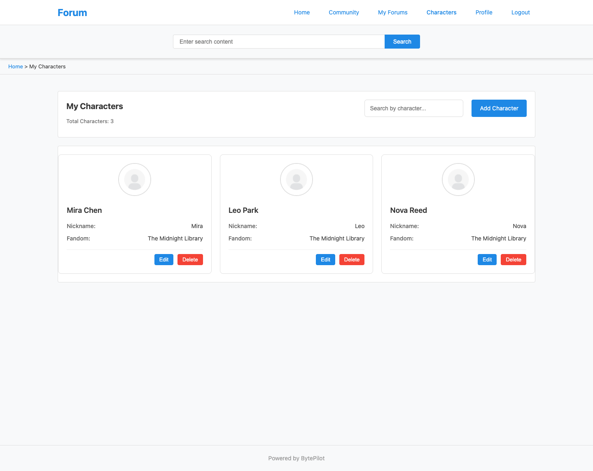
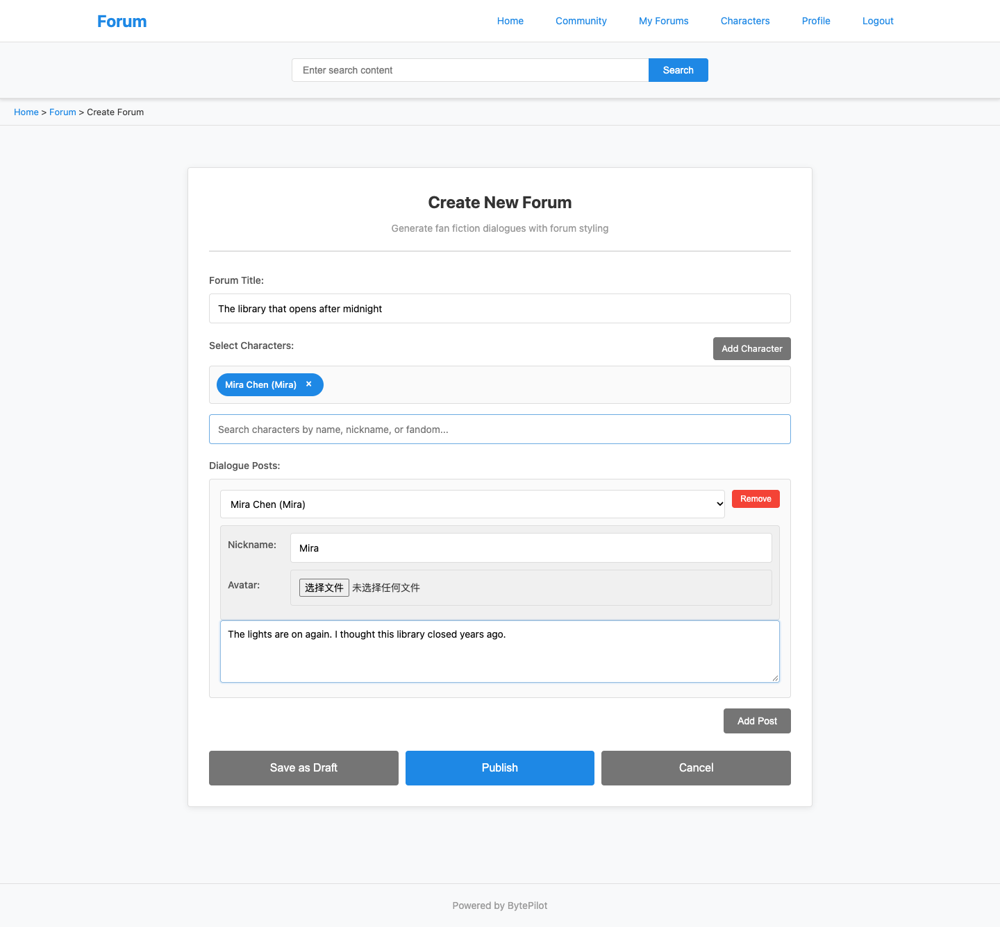
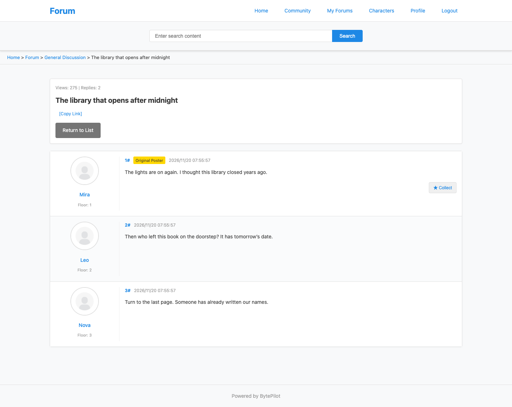

# BytePilot — Forum-Style Dialogue Creator

**Create fictional characters, compose multi-character conversations, and publish them as forum-style threads.**

[](https://github.com/swe-students-fall2025/5-final-bytepilot/actions/workflows/web-app-cicd.yml)
[](https://github.com/swe-students-fall2025/5-final-bytepilot/actions/workflows/ci.yml)

BytePilot, called **Forum Generator** in the original course documentation, is a Flask + MongoDB creative-writing application. Users author the dialogue and arrange it into a forum presentation; the current implementation does not require an LLM or an AI API key.

## User journey

**Register → create characters → compose a thread → save a draft or publish → browse the community.**

| Character management | Thread creation |
| --- | --- |
|  |  |



Screenshots were captured from the real application running locally with fictional demo users and an isolated in-memory database. They show the product flow without access to the course team's database.

## What it demonstrates

| Capability | Concrete implementation |
| --- | --- |
| End-to-end product flow | Accounts, character creation, dialogue composition, draft/published states and community browsing |
| Full-stack development | Flask routes, Jinja templates, JavaScript interactions and MongoDB persistence |
| Data modeling | Users, embedded character data and stored forum threads with character snapshots |
| Delivery workflow | Docker image/Compose configuration, tests and GitHub Actions deployment configuration |

### My contribution — Yuxuan / Esther Feng

I worked on Docker Compose configuration for the web service, connecting the application to MongoDB Atlas, and maintaining configuration and startup documentation so teammates could reproduce and demonstrate the application. The application and interface were developed collaboratively.

## Run locally with Python

Prerequisites: Python 3.11+, and either your own MongoDB instance or Docker for a local database.

```bash
git clone https://github.com/swe-students-fall2025/5-final-bytepilot.git
cd 5-final-bytepilot
python3 -m venv .venv
source .venv/bin/activate
python -m pip install -r web_app/requirements.txt
cp web_app/env.example .env
```

For an isolated local database:

```bash
docker run -d --name bytepilot-demo-mongo -p 127.0.0.1:27017:27017 mongo:7
```

Set these values in your local `.env`, replacing the session-secret placeholder with your own random secret:

```dotenv
MONGO_URI=mongodb://localhost:27017
DB_NAME=forum_db
SECRET_KEY=replace-with-a-random-session-secret
```

```bash
python web_app/app.py
```

Open **http://localhost:5001**, register a demo account and create your first character. On Windows, activate with `.venv/Scripts/activate`.

## Run the web service with Docker Compose

The existing `docker-compose.yml` starts **only the web service**. Supply a separate MongoDB instance. With the local database above and Docker Desktop on macOS/Windows, set `MONGO_URI=mongodb://host.docker.internal:27017` in `.env`. On Linux, configure a reachable database host or an explicit Docker network; `localhost` inside the web container refers to that container.

Alternatively, use a URI from **your own** MongoDB Atlas cluster and configure its access rules. No team-shared `.env` file is needed.

```bash
docker compose up --build
```

The web service is available on port 5001. Stop it with `docker compose down`.

## Tests and deployment

```bash
cd web_app
SECRET_KEY=local-test-session-key python -m pytest --cov=app --cov-report=term-missing
```

- [PR CI](.github/workflows/ci.yml) runs the test gate.
- [Web CI/CD](.github/workflows/web-app-cicd.yml) contains image-build/push and DigitalOcean deployment steps. It requires the operator's own Docker Hub, SSH and environment secrets.
- Local exploration does not require publishing a container or deploying a server.

This is a course prototype. Before public deployment, authentication needs hardening, including password hashing, and database connection strings should be removed from debug output.

## Team

[May Zhou](https://github.com/zz4206) · [Morin Zhou](https://github.com/Morinzzz) · [Jasmine Zhu](https://github.com/jasminezjr) · [Esther Feng](https://github.com/yf2685-beep) · [Eason Huang](https://github.com/GILGAMESH605)

NYU Software Engineering, Fall 2025. [Course instructions](instructions.md) · [License](LICENSE)
